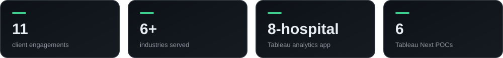
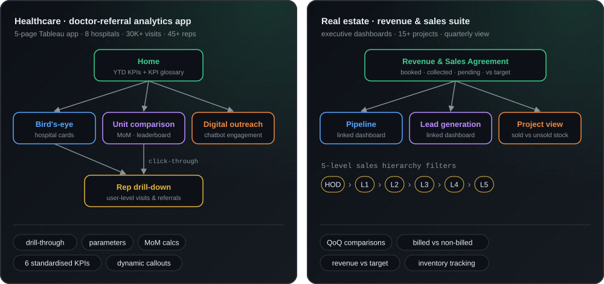

<picture><source media="(prefers-color-scheme: light)" srcset="./assets/header-light.svg" /></picture>

 

<picture><source media="(prefers-color-scheme: light)" srcset="./assets/stats-light.svg" /></picture>

## 🧭 Summary
Tableau Developer with 4+ years of BI experience across healthcare, real estate, ed-tech and enterprise, building multi-page analytics apps, executive dashboards and standardized KPI frameworks for business and leadership teams. Delivered Tableau and Tableau Next solutions across 11 client engagements. Hands-on analytics engineering project work with dbt, Databricks/PySpark, Azure Data Factory, Kafka and Airflow; now extending into Snowflake and AWS.

## 💼 Experience

<picture><source media="(prefers-color-scheme: light)" srcset="./assets/timeline-light.svg" /></picture>

<b>Tableau Developer</b> · Kloudrac Group &nbsp; <code>Aug 2025 – Present</code>

 

- Delivered Tableau analytics for **11 client engagements across 6+ industries** (healthcare, pharma, real estate, logistics, manufacturing, renewable energy), owning each from requirements gathering to dashboard handover.
- Built a **5-page Tableau app** for an 8-hospital doctor-referral program (30K+ field visits, 3.8K referrals, 45+ reps), using drill-through actions, parameters and month-on-month calculations, so leadership could trace performance from network level down to individual reps in one place, supporting hospital-level program reviews.
- Standardized **6 program KPIs** (engagement rate, conversion, visit compliance, TAT) with definitions documented inside the dashboard, so all 8 hospitals measured performance the same way.
- Built an **executive revenue and inventory dashboard** for a real-estate business, with quarter-on-quarter comparisons and 5-level sales-hierarchy filters, so management could track revenue against target, unbilled brokerage and unsold stock across 15+ projects from a single view.
- Built **6 Tableau Next POCs** on Salesforce Data Cloud for manufacturing, real-estate and healthcare prospects, showing agentic analytics and AI-driven insights in client pre-sales.

<b>Data Analyst</b> · Freelance &nbsp; <code>Sep 2024 – Aug 2025</code>

 

- Delivered analytics projects for clients in Tableau, Power BI, SQL and Excel, covering data cleaning, KPI design and dashboard development.
- Built revenue, retention and lead-conversion dashboards that moved clients' recurring reporting from manual Excel files to interactive BI.
- Trained 50+ students and professionals in SQL, Tableau and Power BI.

<b>Associate Solution Leader</b> · Brane Enterprises &nbsp; <code>Jan 2024 – Sep 2024</code>

 

- Delivered BI and reporting projects for enterprise stakeholders end to end, from requirements gathering through stakeholder sign-off.
- Built reusable SQL templates and standardized KPI definitions so business teams reported with consistent metric logic instead of separate spreadsheet calculations.

<b>Subject Matter Expert → Product Analyst</b> · TutorBin &nbsp; <code>Jun 2022 – Dec 2023</code>

 

**Product Analyst** (Sep 2023 – Dec 2023)
- Used Mixpanel to analyse onboarding behaviour and identify funnel drop-off points, giving the product team evidence to prioritize experience improvements.
- Built dashboards tracking DAU, 30-day retention, conversion and feature adoption, giving product and leadership a consolidated view of user activity.
- Ran funnel and cohort analyses to compare user groups and inform feature prioritisation.

**Subject Matter Expert** (Jun 2022 – Sep 2023)
- Mentored 50+ students and professionals in statistics, SQL, Power BI and Tableau; developed practical analytics case studies.
- Supervised interns through structured guidance and regular progress reviews.

## 🧩 Work Highlights
How the two flagship Kloudrac builds are structured. Anonymised: no client names or data.

<picture><source media="(prefers-color-scheme: light)" srcset="./assets/case-studies-light.svg" /></picture>

## 🚀 Projects

<table>
<tr>
<td colspan="2" valign="top">

#### 🛒 AtliQ Commerce: End-to-End Data Platform
     

- **Batch:** metadata-driven ADF ingestion → Databricks Bronze/Silver (Delta Lake, incremental MERGE) → dbt Gold star schema → Power BI / Microsoft Fabric.
- **Streaming:** Kafka → Spark Structured Streaming with watermarking, deduplication and Airflow orchestration.
- **Quality:** 13 dbt models and 18 tests gating GitHub Actions CI, revenue reconciliation, and an idempotency check (re-run the full pipeline and diff the results).

</td>
</tr>
<tr>
<td width="50%" valign="top">

#### 💊 Pharmacy Sales Dashboard

8-view dashboard for pharma sales managers: rep performance, doctor engagement, effort vs. output, target achievement and call-outcome quality.

 

</td>
<td width="50%" valign="top">

#### 📊 Business Insights 360
  

Finance, sales, marketing, supply-chain and executive views over 1M+ transactions across 27+ markets on a star-schema model.

 

</td>
</tr>
<tr>
<td colspan="2" valign="top">

#### 🏨 AtliQ Hotels: Hospitality EDA
    

Analysed ~134K bookings across a 6-table star schema with Pandas (multi-table merges, date features, groupby/pivot aggregations) to compare occupancy, revenue, booking channels and cancellation behaviour by city and room class.

</td>
</tr>
</table>

## 🧰 Skills

<table>
<tr><td><b>BI & Visualization</b></td><td>
      
</td></tr>
<tr><td><b>SQL & Data Modelling</b></td><td>
     
</td></tr>
<tr><td><b>Analytics Engineering</b></td><td>
     
</td></tr>
<tr><td><b>Data Platforms</b></td><td>
        
</td></tr>
<tr><td><b>Learning</b></td><td>
 
</td></tr>
<tr><td><b>Python</b></td><td>
     
</td></tr>
<tr><td><b>Analytics</b></td><td>
    
</td></tr>
</table>

## 🎓 Education & Certifications

<table>
<tr>
<td width="50%" valign="top">

**Education**
- M.Sc. Economics, IIT Roorkee `2017–2019`
- B.Sc. Statistics & Mathematics, CSJMU `2014–2017`

</td>
<td width="50%" valign="top">

**Certifications** (Codebasics)
- Python: Beginner to Advanced for Data Professionals `2026`
- Data Engineering Basics for Data Analysts `2026`
- SQL Beginner to Advanced for Data Professionals `2025`
- Power BI Data Analytics with Fabric Basics `2025`

</td>
</tr>
</table>

 

> _"सर्वं डेटा माया अस्ति – Everything is an illusion… of data."_

